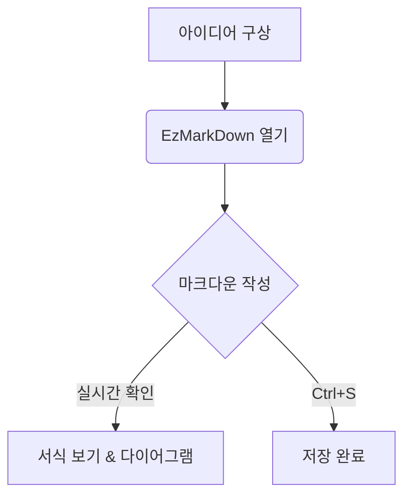

# AI가 가장 좋아하는 문서 형식 마크다운(Markdown), EzMarkDown으로 쉽고 빠르게 활용하세요!!

> **설치 없이 바로 쓰는 초경량·초고속 마크다운(Markdown) 뷰어 및 편집기**  
> 무거운 에디터를 켤 필요 없이, `.md` 파일을 더블 클릭 한 번으로 가볍고 깔끔하게 열고 편집하세요!

<p align="center">
  
</p>

<p align="center">
  
  
  
  
  
</p>

---

## ✨ 왜 EzMarkDown 인가요?

* ⚡ **압도적으로 빠르고 가볍습니다**: 복잡한 설정이나 무거운 설치 과정 없이 즉시 실행됩니다.
* 🌐 **웹 & 데스크톱 모두 지원**: `index.html` 단일 파일로 웹 브라우저에서 바로 열거나, Windows 단일 실행 파일(`.exe`)로 편리하게 사용할 수 있습니다.
* 📊 **Mermaid 다이어그램 실시간 지원**: 순서도, 시퀀스, 클래스 다이어그램 등의 코드 블록을 미려한 그래픽 SVG로 실시간 변환합니다.
* 📑 **스마트 목차(TOC) & 자동 추적**: 헤딩(H1~H6) 자동 목차 생성, 목차 검색, 본문 스크롤에 맞춘 현재 위치 하이라이트(ScrollSpy)를 지원합니다.
* 🌓 **눈이 편안한 다크 모드**: 언제든 버튼 하나로 라이트/다크 테마를 전환할 수 있으며, Mermaid 다이어그램 색상도 함께 자동 동기화됩니다.
* 💾 **손쉬운 원본 파일 저장**: `Ctrl+S`를 누르면 로컬 원본 파일에 바로 덮어쓰기 저장됩니다.

---

## 🚀 빠른 시작 (Quick Start)

### 1️⃣ 웹 브라우저로 바로 쓰기 (가장 간편!)
* [`index.html`](index.html) 파일을 Chrome, Edge 등 웹 브라우저로 더블 클릭하여 실행합니다.
* 브라우저 창 안으로 내 컴퓨터의 `.md` 파일을 드래그 앤 드롭하기만 하면 즉시 열립니다.

### 2️⃣ Windows 데스크톱 앱으로 쓰기 (추천 ⭐)
* [`dist/MDDesk.exe`](dist/MDDesk.exe)를 다운로드하여 바로 실행합니다. (무설치 포터블 단일 파일)
* **팁 (기본 뷰어로 지정하기)**:
  1. 아무 `.md` 파일 우클릭 → **[연결 프로그램]** → **[다른 앱 선택]** 클릭
  2. 다운로드한 `MDDesk.exe`를 선택하고 **'항상 이 앱을 사용하여 .md 파일 열기'** 체크
  3. 이제 탐색기에서 마크다운 파일을 더블 클릭할 때마다 EzMarkDown으로 즉시 열립니다!

---

## 🖥️ 3가지 보기 모드

상단 우측 모드 전환 스위치 또는 단축키를 통해 원하는 작업 환경을 선택하세요:

| 모드 | 단축키 | 설명 |
|:---:|:---:|---|
| **서식 보기** (`Preview`) | <kbd>Ctrl</kbd> + <kbd>1</kbd> | 완성된 서식과 렌더링된 다이어그램을 깔끔하게 읽을 때 최적화된 뷰어 모드 |
| **나란히 보기** (`Split`) | <kbd>Ctrl</kbd> + <kbd>2</kbd> | 좌측 Markdown 원문과 우측 미리보기를 동시에 보며 작업하는 듀얼 모드 (동시 스크롤 지원) |
| **Markdown 편집** (`Edit`) | <kbd>Ctrl</kbd> + <kbd>3</kbd> | 군더더기 없이 마크다운 텍스트 작성에 집중할 수 있는 전체 에디터 모드 |

---

## ⌨️ 편리한 단축키 안내

| 기능 | 바로가기 키 | 설명 |
|---|:---:|---|
| **파일 열기** | <kbd>Ctrl</kbd> + <kbd>O</kbd> | 내 컴퓨터의 Markdown/텍스트 파일 열기 |
| **파일 저장** | <kbd>Ctrl</kbd> + <kbd>S</kbd> | 원본 파일에 즉시 저장 (새 문서일 경우 저장 위치 지정) |
| **새 문서** | <kbd>Ctrl</kbd> + <kbd>N</kbd> | 빈 문서 새로 작성 |
| **목차 접기/펼치기** | <kbd>Ctrl</kbd> + <kbd>B</kbd> | 왼쪽 내비게이션(목차 트리) 사이드바 열기/닫기 |
| **화면 최상단 이동** | <kbd>Ctrl</kbd> + <kbd>Home</kbd> | 문서의 맨 위로 즉시 스크롤 |
| **서식 보기 전환** | <kbd>Ctrl</kbd> + <kbd>1</kbd> | 미리보기 전용 모드로 전환 |
| **나란히 보기 전환** | <kbd>Ctrl</kbd> + <kbd>2</kbd> | 에디터 + 미리보기 분할 모드로 전환 |
| **편집 모드 전환** | <kbd>Ctrl</kbd> + <kbd>3</kbd> | 전체 에디터 모드로 전환 |
| **도움말/창 닫기** | <kbd>Esc</kbd> | 열려 있는 안내 모달 창 닫기 |

---

## 📊 Mermaid 다이어그램 작성 예시

문서 내에 아래와 같이 코드 블록을 작성하면 깔끔한 벡터 그래픽으로 즉시 렌더링됩니다.

````markdown

````

* **지원 다이어그램**: Flowchart(순서도), Sequence Diagram(시퀀스), Class Diagram(클래스), State Diagram(상태도), Gantt(간트차트), Pie(원형차트) 등

---

## 🛠️ 직접 빌드하기 (개발자 안내)

소스 코드를 수정하고 직접 단일 실행 파일(`.exe`)로 패키징하려면 아래 절차를 진행합니다.

### 요구 사항
* [.NET 9.0 SDK](https://dotnet.microsoft.com/download/dotnet/9.0)
* Microsoft Edge WebView2 Runtime (Windows 10/11 기본 탑재)

### 빌드 명령
```powershell
# 단일 포터블 실행 파일(.exe)로 빌드하여 dist 폴더로 출력
dotnet publish .\MDDesk.csproj -c Release -r win-x64 --self-contained false -p:PublishSingleFile=true -o .\dist
```
빌드가 완료되면 `dist/MDDesk.exe` 파일이 생성됩니다.

---

## 📄 라이선스

This project is licensed under the MIT License.
